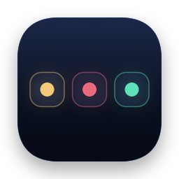
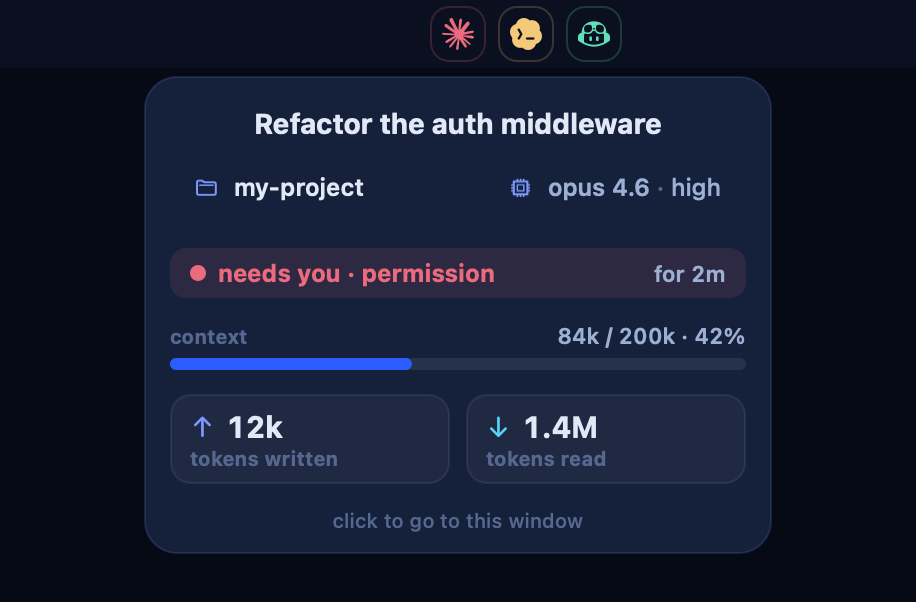

<p align="center">
  
</p>

<h1 align="center">Agent Monitor</h1>

<p align="center">
  
  
  
  
</p>

<p align="center">
  <b>See which of your coding agents needs you, right from the menu bar.</b><br>
  One tinted icon per live <b>Claude Code</b>, <b>Codex</b>, and <b>Copilot CLI</b> session. Hover for details, click to jump to its terminal.
</p>

<p align="center">
  
</p>

## Table of contents

- [Features](#features)
- [Requirements](#requirements)
- [Install](#install)
- [Usage](#usage)
- [Codex approvals](#codex-approvals)
- [Build from source](#build-from-source)
- [Acknowledgments](#acknowledgments)
- [License](#license)

> For how it works, see [GUIDE.md](GUIDE.md) (behaviour and data sources) and [DESIGN.md](DESIGN.md) (visuals and architecture).

## Features

### One glance, every agent

| Icon colour | State | Meaning |
| --- | --- | --- |
| 🟡 Yellow | `working` | Mid-turn: thinking, calling tools, writing |
| 🔴 Red | `needs you` | Waiting on a permission prompt or a question |
| 🟢 Green | `finished` | The last turn is done |
| ⚪ Grey | `ready` | Open, but no turn has run yet |

- Icons appear when a session starts and disappear when it exits. When nothing is running, the strip disappears too.
- Only interactive sessions show up. One-shot prompts, servers, and sub-agents are skipped.

### Details on hover

- Hovering opens a card instantly with the session title, project, model · effort, time in the current state, context-window usage, and tokens written and read.
- The card updates live without flickering or closing.

### Click to jump

- **Terminal** and **iTerm2** select the exact tab, **tmux** switches to the pane, and **kitty** and **WezTerm** focus the window.
- Any other terminal is brought to the front.

### Native and light

- Built with Swift and AppKit, with zero dependencies. The download is about 1 MB.
- It polls once a second and reads only the new bytes of each log, with no shell commands per tick.

## Requirements

- macOS 14 Sonoma or later (Apple Silicon or Intel)
- One or more of [Claude Code](https://github.com/anthropics/claude-code), [Codex CLI](https://github.com/openai/codex), or [GitHub Copilot CLI](https://github.com/github/copilot-cli)

## Install

```bash
curl -fsSL https://raw.githubusercontent.com/sjcsoftware/agent-monitor/main/install.sh | bash
```

This installs **AgentMonitor.app** into `/Applications` (or `~/Applications`) and the `agent-monitor` command into `~/.local/bin`.

To update, run `agent-monitor update`. To remove it, run `agent-monitor uninstall`.

## Usage

```bash
agent-monitor set background && agent-monitor set startup   # always on: now and at every login
```

| Command | Does |
| --- | --- |
| `agent-monitor` | Run in this terminal (<kbd>Ctrl C</kbd> quits) |
| `agent-monitor set background` | Run in the background, detached from the terminal |
| `agent-monitor unset background` | Stop the background instance |
| `agent-monitor set startup` | Start automatically at login |
| `agent-monitor unset startup` | Don't start at login |
| `agent-monitor status` | Show what's running and configured |
| `agent-monitor stop` | Quit any running instance |
| `agent-monitor dump` | Print every session as JSON |
| `agent-monitor update` | Update to the latest release |
| `agent-monitor uninstall` | Remove Agent Monitor |

In the menu bar:

| Do this | To |
| --- | --- |
| Hover an icon | See the session's details |
| Click an icon | Bring its terminal window (or tab) to the front |
| Right-click the strip | Toggle Codex approval hooks, or quit |

> The first click on a Terminal or iTerm2 session asks for permission to control that app, so Agent Monitor can select the exact tab. For other terminals, granting **Accessibility** lets it raise the exact window.

## Codex approvals

Codex doesn't log its approval prompts, so Agent Monitor uses a tiny Codex lifecycle hook to know when Codex is waiting on you:

```bash
agent-monitor hooks install     # or accept the one-time offer on first launch
```

- This adds one entry per event to `~/.codex/hooks.json` that points at a helper inside the app. Your existing hooks are kept.
- The next time Codex starts, it asks you to trust the new hooks. Choose **Trust**.
- To remove them, run `agent-monitor hooks uninstall`.

Claude Code and Copilot CLI need no setup.

## Build from source

You need the Xcode **Command Line Tools**.

```bash
git clone https://github.com/sjcsoftware/agent-monitor.git
cd agent-monitor
scripts/test.sh         # unit tests
scripts/build.sh        # → dist/AgentMonitor.app and dist/AgentMonitor.zip
dist/AgentMonitor.app/Contents/Resources/agent-monitor
```

## Acknowledgments

- Agent marks: Claude from [simple-icons](https://github.com/simple-icons/simple-icons) (CC0), and Codex and Copilot from [lobe-icons](https://github.com/lobehub/lobe-icons) (MIT). All trademarks belong to their owners.

## License

Copyright © 2026 chaseungjoon.

Agent Monitor is free software: you can redistribute it and/or modify it under the terms of the
[GNU General Public License v3.0](LICENSE) as published by the Free Software Foundation, either
version 3 of the License, or (at your option) any later version. It is distributed in the hope that it
will be useful, but WITHOUT ANY WARRANTY; see the license for details.
